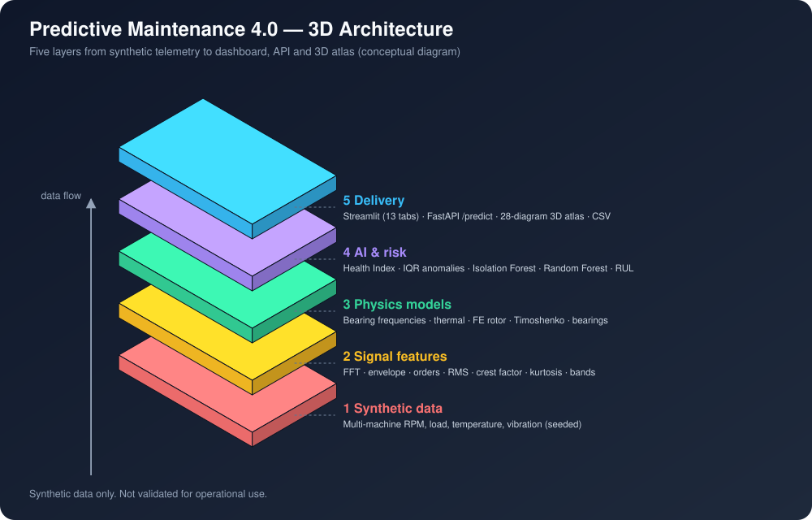
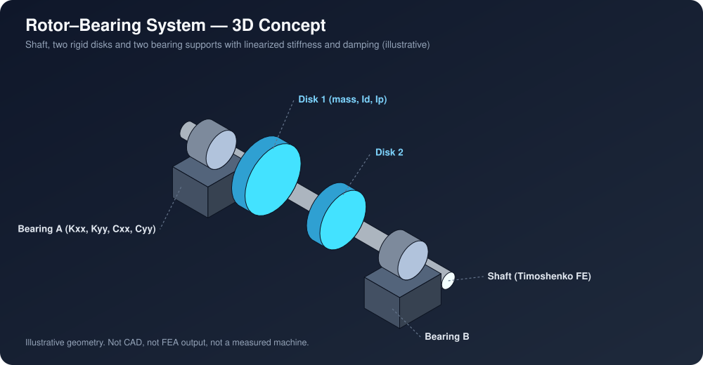
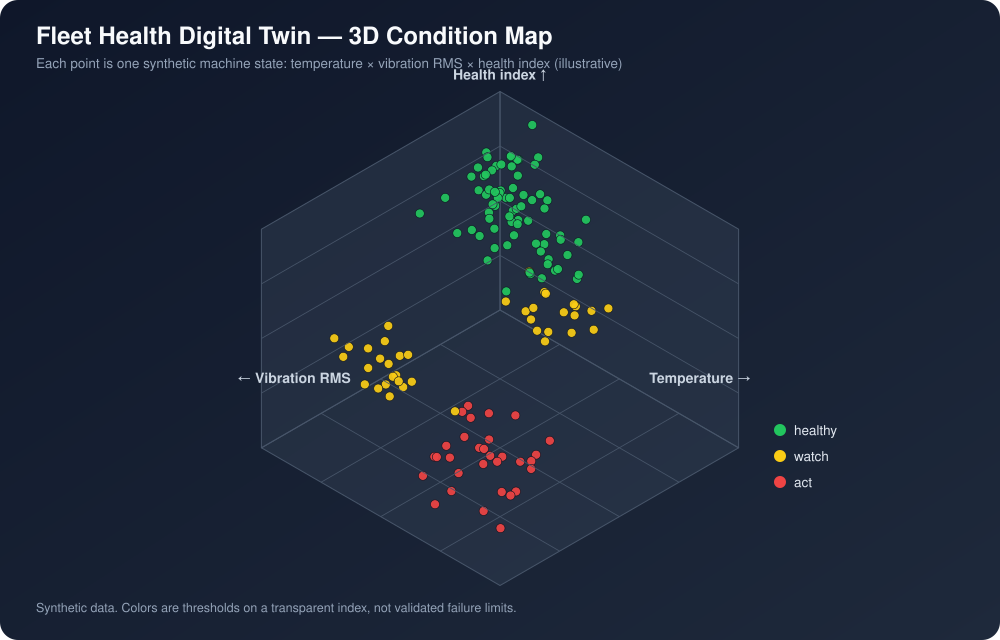
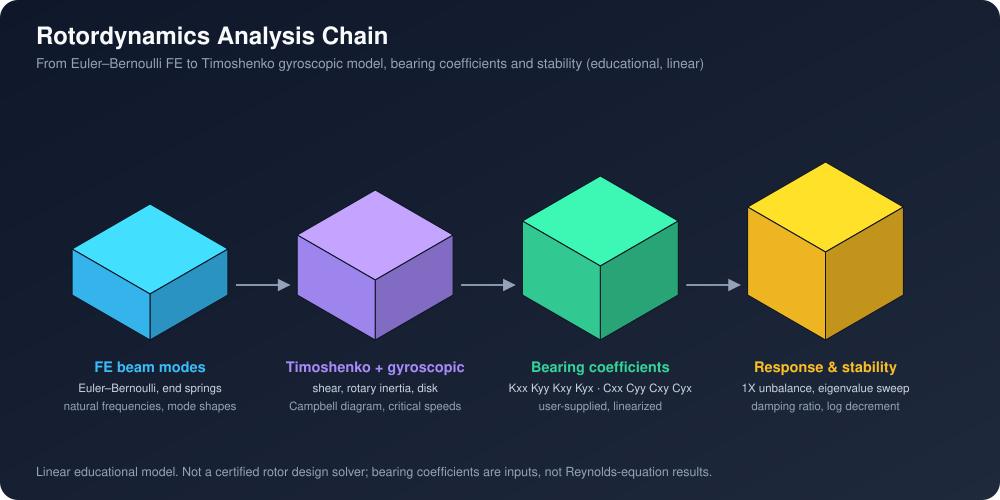
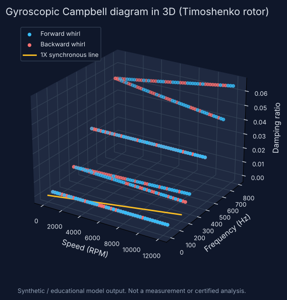
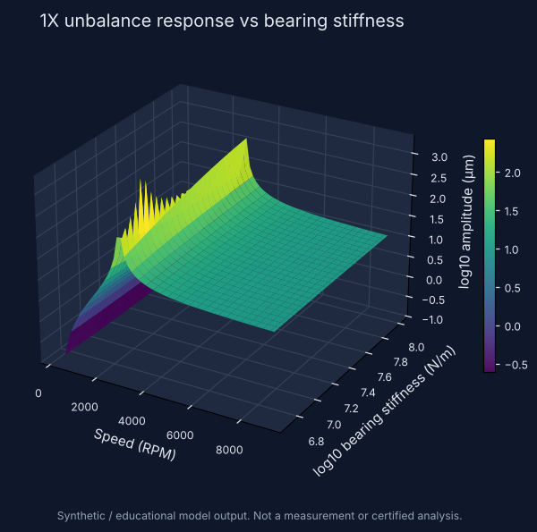
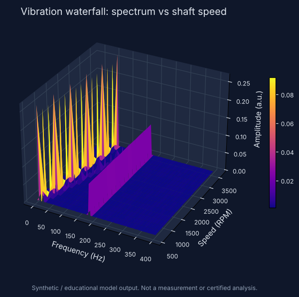
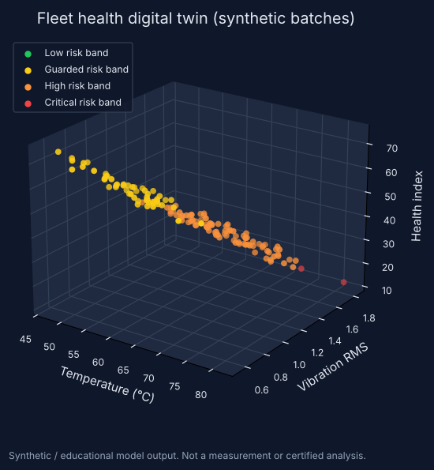
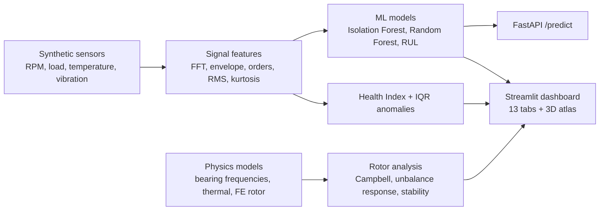

# Predictive Maintenance 4.0 — Physics-Aware Industrial Digital Twin

   

A mechanical-engineering and data-science portfolio project: synthetic multi-machine telemetry, vibration diagnostics, simplified thermal and rotor-dynamics models, explainable ML (anomaly, fault type, remaining useful life), a 13-tab Streamlit dashboard, a FastAPI endpoint and a 28-diagram interactive 3D atlas.

> All data is synthetic and labels are rule-generated. This is an educational and portfolio tool, not a certified machinery-diagnostic or safety system.

## 3D Architecture



### More 3D diagrams

| Rotor–bearing system | Fleet health map |
|---|---|
|  |  |



### Real 3D outputs from the project's own models

Generated by `make_figures.py` from the included Python models (synthetic inputs, educational linear models).

| Gyroscopic Campbell diagram | 1X unbalance response surface |
|---|---|
|  |  |

| Vibration waterfall | Fleet health map |
|---|---|
|  |  |

These SVGs illustrate the design. The live, rotatable versions are the 28 Plotly 3D charts in the dashboard's **Complete 3D Engineering Atlas** tab.

### Data flow



## Features

- Bearing kinematics: FTF, BSF, BPFO, BPFI
- Synthetic fleet with healthy, imbalance, misalignment and bearing-defect states
- FFT, Hilbert envelope spectrum, order spectrum, RMS, crest factor, kurtosis, band energy
- Lumped thermal energy-balance model (not CFD)
- Transparent Health Index, IQR anomaly flags, holdout-machine ML validation, permutation importance
- Euler–Bernoulli and Timoshenko FE rotor models, gyroscopic Campbell diagram, critical-speed screening
- Linearized bearing coefficients (K and C matrices), 1X unbalance response, eigenvalue stability sweep
- Maintenance work-order queue and CSV exports
- 28 interactive 3D Plotly diagrams (fleet, AI, vibration, rotor, data quality)

## Quick start

```bash
python -m venv .venv
source .venv/bin/activate        # Windows: .venv\Scripts\activate
pip install -r requirements.txt

python -m unittest discover -p "test_*.py" -v     # run the tests
streamlit run dashboard.py                        # dashboard
python train_models.py                            # train models into artifacts/
python make_figures.py                            # re-render the fig_*.png 3D charts
uvicorn api:app --reload                          # API at http://127.0.0.1:8000/docs
```

`make install`, `make test`, `make run`, `make train` and `make api` do the same.

`train_models.py` regenerates the synthetic dataset, trains the three models, evaluates them on a held-out machine and writes `artifacts/` (models, feature list, `metrics.json`, `metadata.json`). Use `--machines`, `--cycles`, `--seed` and `--out` to change the run. Metrics measure how well the models recover rule-generated labels; they are not evidence of real-world accuracy.

### API example

```bash
curl -X POST http://127.0.0.1:8000/predict -H "Content-Type: application/json" -d @sample_payload.json
```

The request body needs the 21 feature fields listed in `feature_columns.json` (see `SensorFeatures` in `api.py`). Without artifacts the endpoint answers 503.

## Project structure

A **flat repository**: no subfolders. Files are grouped by name.

| Files | Purpose |
|---|---|
| `dashboard.py` | Streamlit app with 13 tabs |
| `api.py`, `train_models.py` | FastAPI inference and headless model training |
| `monitoring.py`, `v8_engine.py`, `v9_intelligence.py`, `v10_enterprise.py`, `v11_validation.py` | Fleet simulation, validation, Health Index, scoring, holdout evaluation |
| `signal_diagnostics.py`, `advanced_diagnostics.py`, `v16_rotordynamics.py`, `v17_rotor_lab.py` | Vibration and order analysis, Campbell and Bode data |
| `v18_fem_rotor.py`, `v19_advanced_rotor.py`, `v20_bearing_response.py` | FE, Timoshenko, bearing and stability models |
| `v21_3d_atlas.py` | Builds the 28 3D diagrams |
| `test_*.py` | Unit tests |
| `Predictive_Maintenance_Digital_Twin.ipynb` | Walkthrough notebook |
| `*-3d.svg`, `fig_*.png`, `make_figures.py` | README diagrams; the PNGs are rendered by the script from the project's models |
| `CHANGELOG.md` | Release history v6 to v21 (merged from the old per-version notes) |
| `Makefile`, `Dockerfile`, `ci.yml.example`, `requirements.txt` | Tooling |

The `v8`–`v21` prefixes are the release in which each module was introduced. Generated folders (`artifacts/`, `outputs/`) are git-ignored.

## Continuous integration

GitHub only runs workflows from `.github/workflows/`, a folder, so the workflow ships as `ci.yml.example`. To enable it: **Add file → Create new file**, type `.github/workflows/ci.yml` as the name, paste the contents of `ci.yml.example`, commit.

## Docker

```bash
docker build -t predictive-maintenance .
docker run -p 8000:8000 predictive-maintenance
```

The image trains the synthetic models at build time and serves the API as a non-root user.

## Limitations

- All data is synthetic; labels follow fixed rules, so scores are not evidence of real-world prediction quality.
- Thermal behavior is a lumped first-order model, not CFD.
- Order tracking maps FFT bins to orders; it is not tachometer-based angular resampling.
- Bearing formulas assume idealized geometry. Bearing K and C coefficients are user inputs, not Reynolds-equation results.
- The rotor models are linear and educational, not a certified rotor design solver.
- No PLC, SCADA or live sensor integration. Replace all limits with site-approved values before any real use.
- The experimental modal series stays empty until measured data is uploaded.

## Suggested GitHub topics

`predictive-maintenance` `mechanical-engineering` `vibration-analysis` `digital-twin` `rotor-dynamics` `machine-learning` `streamlit` `fastapi` `plotly` `data-science`
